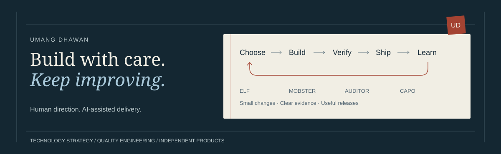

# Umang Dhawan

**Senior Consultant at EY Studio+ · Chicago**

I connect technology strategy with hands-on delivery. My work spans quality
engineering, cloud reliability, and practical AI. Outside client work, I design,
build, and maintain independent software products.

[Explore my portfolio](https://udhawan97.github.io/) · [LinkedIn](https://www.linkedin.com/in/umangdhawan97) · [Email](mailto:umangdhawan97@gmail.com)



## A working practice for AI-assisted engineering

I use scheduled AI workflows to keep projects moving after the first launch.
I define the product, priorities, permissions, and acceptance criteria. The
agents work within those limits; I remain accountable for what ships.

| Role | Responsibility | Useful output |
| --- | --- | --- |
| **Daily Elf** | Build one useful fix or feature slice. | A focused change with tests and a clear handoff. |
| **Mobster at Work** | Resume open work and repair demonstrated gaps. | A checked candidate, or a precise remaining blocker. |
| **Auditor** | Challenge results and inspect failure paths. | Evidence-backed findings and missing checks. |
| **Weekly CAPO** | Prioritize across projects, finish stranded work, and qualify releases. | Verified delivery and a concrete next phase. |

These are workflow roles, not a claim of unattended or continuous operation.
Required reviews, repository protections, and publication approvals still apply.
A clean audit can end without a commit.

### A public example: Nimanto v0.10.1

The [security and dependency change](https://github.com/udhawan97/Nimanto/pull/58)
started with reproduced problems, then added focused regression coverage. Its
verification included 650 package/script tests on Node 24 and 26, 32 WebKit
journeys, and disposable upgrade and recovery checks. The reviewed source
merged; the [release](https://github.com/udhawan97/Nimanto/releases/tag/v0.10.1)
assets and checksums were checked separately from the public documentation.

A failing keyboard test exposed a real focus-restoration problem. Fixing its
cause and keeping the regression test improved the next run. That is the loop:
**observe a failure → repair the cause → preserve the lesson → verify again.**
The linked records state the limits of the checks. This is a November 2026
example, not a live security dashboard.

### Learning should travel beyond the code

[learnings-via-graphics](https://github.com/udhawan97/learnings-via-graphics)
is a source-only collection of illustrated lessons for beginners. Topics rotate
across engineering, emerging technology, everyday life, and career questions.
Each edition offers a brief, explanatory graphics, a worked example, something
to try, and accessible supporting sources. Coverage checks discourage repeatedly
polishing one topic while neglecting the rest.

Explore the [lesson archive](https://github.com/udhawan97/learnings-via-graphics/blob/main/archive.md)
or the [database-index lesson](https://github.com/udhawan97/learnings-via-graphics/blob/6647511ca25060daee153a679808d1ff51d26936/editions/2026-11-25-database-index-tradeoff/brief.md).
The portfolio links directly to the learning repository; it does not host or
publish the lessons.

## What this demonstrates

- **Product judgment:** turn a broad goal into a small, useful next phase.
- **Engineering discipline:** inspect failures, test boundaries, and preserve user data.
- **AI workflow design:** give each role a clear job, permissions, and a handoff.
- **Release ownership:** distinguish source checks, user acceptance, publication, and deployment.
- **Clear communication:** make technical decisions and learning material easy to follow.

The portfolio also covers my client work, including release safety, cloud
observability, federal cloud delivery, and a platform launched to more than
100 retail locations. Client outcomes and this independent practice are presented
separately.

## Maintaining this site

```
├── index.html                      ← the whole site (hand-coded, zero frameworks 💪)
├── assets/css/portfolio.css        ← indigo and paper visual layer
├── assets/maintenance-practice.svg  ← README illustration
├── assets/js/work.js               ← roles, workstreams & outcomes (impact map + case studies)
├── assets/js/projects.js           ← the "Featured builds" cards: data + renderer
├── assets/js/util.js               ← the esc() the two share (loads first)
├── assets/headshot.jpg             ← my face
├── tests/                          ← node --test, zero dependencies
├── Umang_Dhawan_Resume_Formal.pdf  ← the serious one (ATS-friendly)
└── Umang_Dhawan_Resume_Modern.pdf  ← the pretty one (charts! donuts! 📊🍩)
```

The three scripts in `assets/js/` are plain classic scripts sharing one global
scope — no modules, so `index.html` still opens straight from the filesystem.
They load before the main script, which expects their markup to already be in
the DOM. `util.js` goes first: it's the only place `esc()` may be declared.

### Tests

```bash
node --test          # no install, no dependencies, no build
```

### Visual direction

The opening connects two sides of my practice: dependable systems for clients
and understandable products built independently. It puts my name, a short
introduction, and selected client outcomes together, with direct paths to both
kinds of work. The product illustrations retain their individual identities.

The visual direction pairs indigo ink and warm paper with restrained vermilion
accents. Avenir Next/system sans carries the body; Iowan Old Style/Georgia brings
a quieter editorial voice to headings. All fonts use local fallbacks. The
maintenance loop and native disclosure panels explain the workflow without a
new JavaScript dependency. Its core content works without JavaScript.

Product artwork keeps each application's identity. Both themes, visible focus,
reduced motion, and narrow screens remain part of acceptance. The contribution
chart is an existing third-party image from `ghchart.rshah.org`, loaded lazily
without a referrer; its fallback retains a direct profile link. A contribution
chart is activity context, not proof of quality.

Preview with `python3 -m http.server 8765 --bind 127.0.0.1`, then open
[localhost:8765](http://localhost:8765).

### GitHub Pages delivery

The legacy `main:/` publisher remains authoritative until a separately
authorized cutover. It automatically publishes changes merged to `main`.
The staged `.github/workflows/pages.yml` workflow runs tests and packages the
static artifact for pull requests and pushes to `main`; those workflow runs
do not deploy. Its separate Actions deployment path requires a manual dispatch
on `main` with `deploy=true` and an explicit full 40-character `deploy_sha`
that is already an ancestor of `main`. These manual controls do not stop the
current legacy publisher.

Cutover and recovery runbook:

1. **Pre-deploy verification:** record the current public known-good SHA and
   Pages source, then run `node --test` at the candidate SHA. Confirm the
   workflow's **Test and package** job succeeds for that exact SHA.
2. **Authorized cutover:** in a separately authorized cutover window, change
   the repository's Pages source from **Deploy from a branch** (`main:/`) to
   **GitHub Actions**. From the workflow on `main`, manually dispatch with
   `deploy=true` and the verified candidate's full SHA.
3. **Post-deploy acceptance:** require the workflow's deployed-SHA marker,
   root document, 10 project templates, 6 workstream templates, classic
   scripts, key images, and both resume files to pass its HTTP smoke. Then open
   the public site in the target browser and check navigation, project cards,
   workstream disclosure, theme persistence, and downloads. The automated HTTP
   smoke does not prove a browser smoke.
4. **Rollback trigger and action:** if the site is unavailable, the deployed
   SHA differs, or the live smoke fails, manually dispatch the same workflow
   from `main` with `deploy=true` and the recorded known-good SHA. This verifies
   and redeploys that exact artifact. If the Actions path itself is unavailable,
   restore the recorded `main:/` source only under the cutover's pre-authorized
   contingency after `main` has been restored to the known-good tree.
5. **Stop and report:** stop if the candidate is not on `main`, verification
   fails, the known-good SHA is missing, provider authority is unavailable, or
   restoration would require an unapproved history rewrite.

No provider setting, deployment, or rollback drill is performed by adding this
workflow and runbook.

### Adding a project card

The project cards render from one place, so a new one is two edits:

1. Add an entry to `PROJECTS` in `assets/js/projects.js` (name, copy, tags, links, status pill).
2. Add its bespoke visual as `<template class="ghp-scene" data-project="your-id">` in the `.ghp-grid` in `index.html`.

### Adding a workstream

The impact map, its detail panel, and the case-study rows all read the same
entries, so a new workstream is also two edits:

1. Add an entry to `WORKSTREAMS` in `assets/js/work.js` (role, title, copy, tags, outcome).
   The `*stars*` in an outcome mark what the case-study row emphasises.
2. Add its row icon as `<template class="work-icon" data-ws="your-id">` in `#caseStudiesBody`.

The role and outcome links come from the entry itself — there's no separate
connection list to update.

In both cases the tests will tell you if you miss the template, point an icon at
a file that isn't there, or reference a role that doesn't exist.

Designed and built with AI assistance. Project claims link back to public source and release records.
